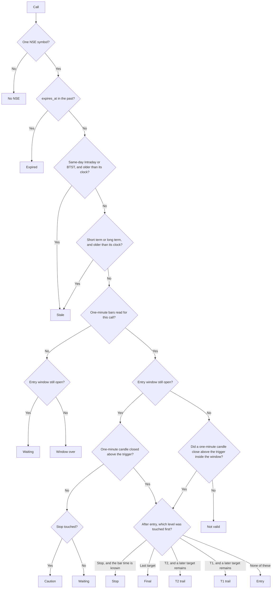
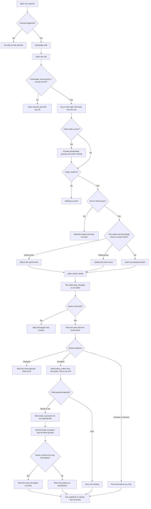

# Flowcharts

The mark on a call is generated by the first flowchart in this file. A word saved on the row, including a word brought in with older data, is not a status. The generator reads the name match, `expires_at`, the horizon clock, the entry window, and the one-minute bars from Fyers for an NSE cash call. The Buy and Sell section is a separate path. It does not change the mark.

Add the next rule as a new section. Keep the case list, the flowchart, and the marks together.

## Call progress

Entry, Caution, Not valid, T1 trail, T2 trail, Final, and Stop are the price marks. Each one that has a minute shows that minute on the chip, in IST. The entry minute is when the one-minute candle closed. A stop or target minute is the minute of the bar that traded there. The bars are read for an actionable NSE cash call when the Fyers app is saved. Finished minutes are saved for that symbol. They are not a column on the signal. A day already saved is not read again. The minute still forming stays in memory and is filled from the data socket. A finished mark is not read again. The stock list labels the last traded price LTP while the cash session is open and Last LTP after it. The price is green when it is above the previous close and red when it is below, with that percent beside it. A price without the change stays in the body ink. A chart icon on the list and on the call draws those bars at 1 minute and 5 minutes. The horizontal axis shows the bar time in IST. The price scale is on the right and the chart opens on the latest candle. Dragging the chart moves through the session. Dragging the price scale changes the candle height. Dragging the time scale, or the wheel, fits more candles in the view. The crosshair shows that bar's time and price. Until those bars are in, the chip stays Waiting or Window over, and it does not invent a time.

This path is for a buy call whose message gives an above price, a stop, and at least one target. "Above price" is the trigger. A one-minute candle **close** above that price is the entry. A wick, or the last traded price alone, is not an entry. A stop or a target is a **touch**. The entry window is the one already used on the phone: 30 minutes after the post, or 15:30 IST, whichever is sooner. On a weekend the window is already over at the post time.

The seven cases:

| Case | What happened | Mark |
| --- | --- | --- |
| 1 | Above price not reached, and the window is still open | Waiting |
| 2 | Above price not reached, and the window has ended | Not valid |
| 3 | A one-minute candle closed above the above price inside the window | Entry |
| 4 | Entry, then price touches T1, and a later target remains | T1 trail |
| 5 | Entry, then price touches T2, and a later target remains. Some messages have no T2 | T2 trail |
| 6 | Entry, then price touches the last target in the message | Final |
| 7 | Window still open, above price not reached, and price touches the stop | Caution |

Reading of cases 4, 5, and 6, for review: the mark is the furthest target touched. T1 or T2 is a trail only when the message has a target after it. The last target is Final, so there is nothing left to trail. A message with one target treats that target as the last one: a touch is Final. A message with two targets treats the second as the last one: T1 is a trail, and the second target is Final.

Two branches are not in the seven cases. They are drawn so the path has a place to end, and they stay open until accepted:

- After entry, a touch of the stop is **Stop**. If the stop and a target were both touched and the one-minute bars do not show which came first, the mark stays Entry. The call is not given a target exit or a stop exit from a guess.
- A sell uses the same path in the other direction. Entry is a one-minute close below the trigger. The stop is a touch of the high. A target is a touch of the low. The minute on the chip is the same kind of minute as a buy.

There is no Withdrawn activity. A saved word "withdrawn" or "expired" does not create a mark.

Same-day Intraday and BTST become Stale after their clock. The starting value is 30 minutes. Short term and long term have their own clocks, starting at 30 days. An admin changes the three numbers on Admin configuration. The next read uses the saved numbers. Intraday to 7 days is not one of those clocks. It expires 7 days after the post. When a short-term or long-term clock is 30 days, that is the same moment as expiry, so the chip says Expired. A shorter number marks the call Stale first.

Waiting and Caution can still move to Entry only while the stop has not been touched. A stop touch before a one-minute close through the trigger is Caution, and that call does not become Entry. Caution, a trail, Not valid, Final, and Stop leave Actionable and are not an entry. A fresh call is required. While the one-minute bars are still being read, a last price that has already traded through a target or the stop leaves Actionable. The pill says Final, T1 trail, T2 trail, or Stop, with no minute, until the bars name that minute.

### Marks on the row

The row shows one pill beside the symbol. The pill is a 6px dot and one short label in 13px type. The name stays on that line. A long name shortens. The explanation sentence is not on the row. It is under the pill after the call is opened.

The time is the minute in IST. A mark from an earlier day includes the date, as in `Entry 23 Oct 10:05`. Not valid, Waiting, Window over, Checking, Stale, Expired, and No NSE have no time.

| Pill text | Colour | Meaning | Actionable |
| --- | --- | --- | --- |
| Waiting | Green | The window is open. No one-minute close through the trigger is recorded. | Stays |
| Entry 10:05 | Green, deeper than Waiting | A one-minute candle closed through the trigger inside the window. The time is the minute that candle closed. | Stays |
| Final 11:40 | Green | The last target was touched in that minute. That is the exit. | Leaves. All still shows it |
| T1 trail 10:31 | Green, a shade lighter | T1 was touched in that minute and a later target remains. | Leaves. All still shows it. Not an entry until a fresh call |
| T2 trail 12:05 | Green, a shade lighter | T2 was touched in that minute and a later target remains. A later target uses the same pill, named for that target. | Leaves. All still shows it. Not an entry until a fresh call |
| Window over | Stone | The window has ended and the one-minute bars are not in yet. This is not Not valid. | Stays |
| Checking | Stone | The one-minute bars are being read. | Stays |
| Not valid | Stone | The window ended with no one-minute close through the trigger. There is no entry time. | Leaves. All still shows it |
| Caution 10:14 | Amber | The stop was touched in that minute, before a one-minute close through the trigger. | Leaves. All still shows it. Not an entry until a fresh call |
| Stale | Amber | The horizon clock has passed. | Leaves. All still shows it |
| Stop 11:52 | Red | After entry, the stop was touched in that minute. That is the exit. | Leaves. All still shows it |
| Expired | Warm neutral | `expires_at` is in the past. | Leaves. All still shows it |
| No NSE | Plain | The posted name did not match one NSE symbol. | Leaves. All still shows it |

Waiting is `#e7f6ee` with ink `#16804A`. Entry is a deeper green, `#d3eadc` with ink `#0d5c48`. Final uses the Waiting green. The lighter trail green is `#e5f2ea` with ink `#0b6a34`. Stone is `#e7e0d2` with ink `#3a4450`. Amber is `#f6ecd4` with ink `#6d4e12`. Stop is `#f8e6e4` with ink `#9c1d1d`. Expired is `#E8E1D4` with ink `#626B78`. Plain is `#fffdf8` with ink `#1c2430`. The dot uses the ink colour.

The published stop stays on the row. "Trail" says a later target remains. It does not change the stop price. A trail-price rule is not in the seven cases.

Last traded price can sit on the same line as the trigger, the stop, and the targets. A stop or a target on the wrong side of the buy is moved by a power of ten when the current price, or the buy, shows a missing zero or a slipped decimal. The mark is then read from the corrected level. The final target on that line is Last. T2 is shown only when a price sits between the first target and the last. The last traded price does not set Waiting, Entry, Caution, or Not valid. A last price already through a target or the stop takes that call off Actionable and the pill says Final, a trail, or Stop, with no minute, until the bars name that minute.

## Buy and Sell

Home is one scanner. A registered channel shows its calls. Equity, F&O, or Commodity changes the view and does not grant access. An unregistered channel says so and shows no calls. Buy and Sell appear on an open call when that call is still executable and the server quantity is at least one lot. The ticket opens filled from the call. The trader can edit the product, trigger, stop, and targets. The server recalculates quantity from the edited trigger and stop. Risk-reward is shown from the trigger and does not change the quantity. Preview stores nothing.

Confirm stores one `proposed` row in `order_intents` for that trader and call: side, product, trigger, stop, targets, and the server quantity. Orders lists those rows for the signed-in trader. The idempotency key is unique. A second tap with the same prices returns that row. An edit of an unsent intent updates the same row. This build stops there. Zerodha is not called. `broker_orders`, `trade_executions`, and `position_snapshots` stay empty. The stop and targets stay inactive until a later broker confirmation.

The broker send below is the path for when submission exists. The intent is already committed before that call. A broker response of accepted is not a fill. Fills and positions are written from what the broker reports. An unknown response is reconciled before any retry.

### Failures

A check that fails after the call is known writes an audit row. It does not write an intent, except when a saved intent already exists and the new confirmation disagrees with it. That saved row is left as it was.

| Step | Failure | Result | Data saved |
| --- | --- | --- | --- |
| Scanner | The channel is not registered | The screen says so and lists no calls | None |
| Scanner | A segment filter is on | The list changes. Access does not | None |
| Call | The call is unmatched, stale, or expired | Buy and Sell stay off | None |
| Call | The mark is Not valid, Caution, a trail, Final, or Stop, or the last price has traded through the first target or the stop | Buy and Sell stay off | None |
| Call | One lot would lose more than the maximum rupee risk | Quantity is none. Buy and Sell stay off | None |
| Ticket | The trader edits the trigger or the stop | Quantity is recalculated. The ticket stays open | None. Preview writes nothing |
| Confirm | The call is no longer executable | 409 `signal_not_actionable` | Audit only |
| Confirm | The product is outside the risk profile | 422 `product_not_allowed` | Audit only |
| Confirm | The quantity is not the server quantity | 409 `quantity_mismatch` | Audit only |
| Confirm | Zerodha is not signed in | 409 `broker_not_connected` | Audit only |
| Confirm | The same confirmation key was saved with different prices | 409 `idempotency_conflict` | The earlier intent stays |
| Confirm | The same key, or the same open call, has the same prices | The existing intent is returned | No second row |
| Confirm | The checks pass | One `proposed` intent | `order_intents` and an `order.confirmed` audit |
| Broker send | The broker rejects the entry | The intent is rejected | No fill and no position are invented |
| Broker send | The response is missing, timed out, or unknown | Fail closed | Reconcile with the broker before another send |
| Broker send | The broker accepts the entry | The broker order is stored | `broker_orders`. The intent is not marked filled |
| Broker send | The broker reports a partial or full fill | Protection is sized to that fill | `trade_executions` from the broker |
| Broker send | The stop or a target is not confirmed | The position is shown as unprotected | The stop and targets stay inactive |
| Broker send | An exit would sell more than the remaining position | The exit is rejected | The broker position is left as reported |

Last traded price is a Fyers quote. It does not set the quantity, the mark, or whether the call can be confirmed. A missing fund check is stated. It is not shown as a zero balance or as a pass. Capital set aside is not the numerator of the quantity.
