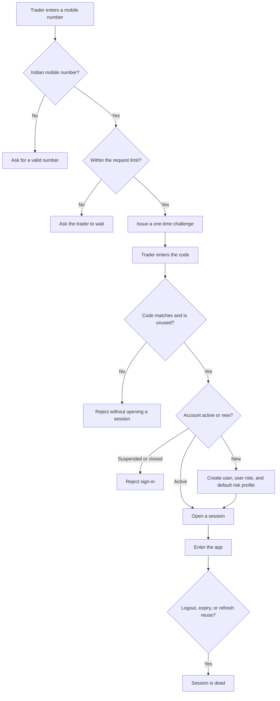
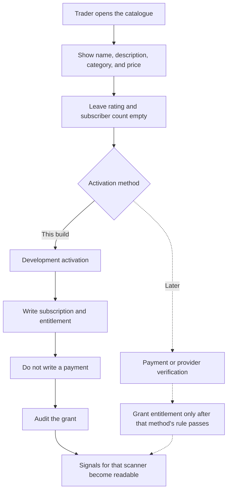
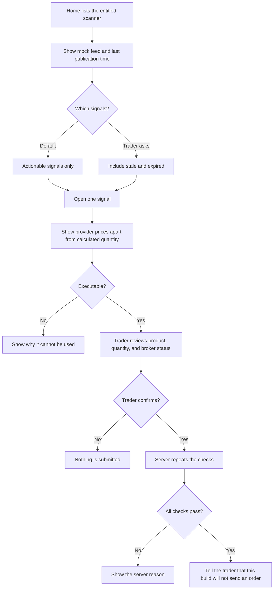
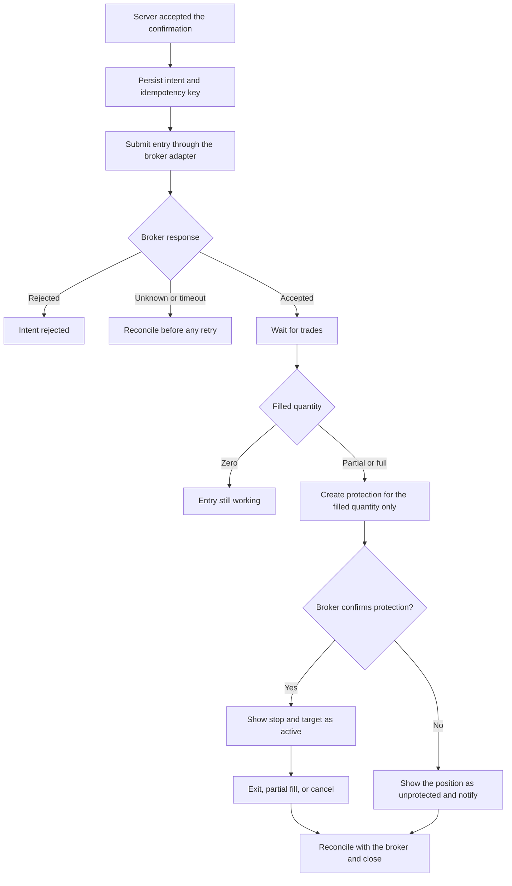
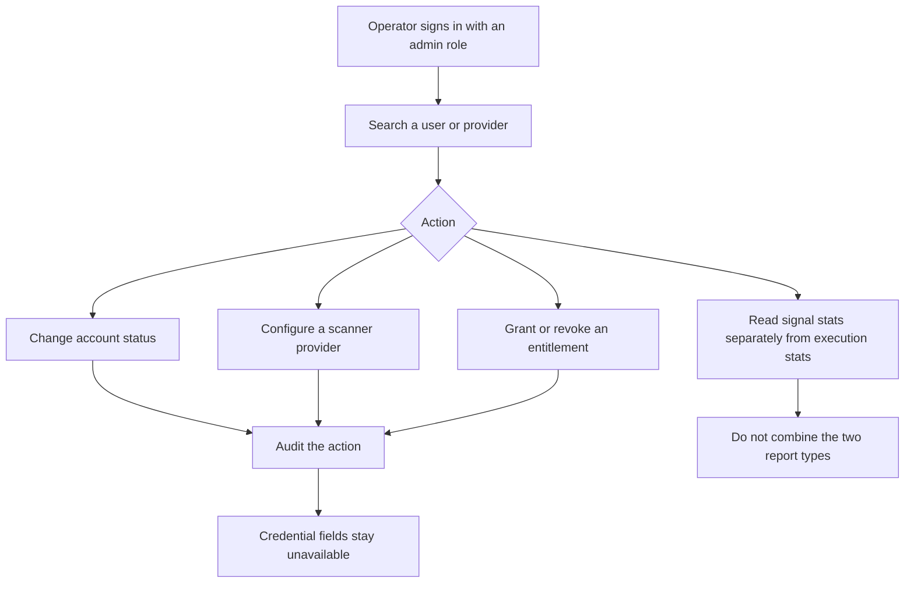

# Business processes

These are the operating processes, not screen wireframes. The first three are the foundation. The order lifecycle after confirmation is the target process for simulated trading and is drawn separately so it is not mistaken for current behavior.

## 1. Open a session

In development the challenge code is shown by the API so the app can be used without SMS. That display is part of the development process only. Production has no process step that reveals the code.

A new account starts with a development risk profile: capital allocation 50,000 INR, maximum risk 500 INR, maximum quantity 500, maximum exposure 200,000 INR, and both MIS and CNC allowed. Those numbers are starting preferences, not a recommendation. The trader can change them. The change is audited.

## 2. Gain access to a scanner

The catalogue price on Mani's, 999 INR monthly, describes the offer. Activating it does not charge the trader in this build. A second activation returns the same subscription.

Activating the scanner does not by itself open every source channel. Equity, F&O, and commodity are separate channels when the provider runs them that way, and each one is registered on its own. Horizon words stay inside the channel that published them.

If the catalogue has not been seeded, the feed sync tells the developer to run the seed command instead of inventing a provider.

## 3. Review a signal

The home list is one scanner. It opens on every registered channel. Equity, F&O, and Commodity narrow that list and remember the last choice on the device. Choosing a channel the trader has not registered shows that fact and no calls. Choosing All names any channel left out. The horizon is printed on each call. There is no second row of horizon tabs. "Intraday" and "Intraday to 7 days" stay different text unless a channel adapter maps them on purpose. Closed calls stay behind the separate control that reveals stale and expired signals.

On the detail screen the trader can also see the risk-reward of each target, measured from the trigger to the target and from the trigger to the stop. That figure does not change the suggested quantity. If one contract lot would lose more than the maximum rupee risk, the quantity is none and the screen says so.

The trader should be able to see three different facts at once:

1. What Mani's supplied, including trigger, stop, and targets.
2. What Quantivo calculated, including the formula and the statement that capital allocation is not the amount at risk.
3. Whether a simulated broker session exists, and that order placement is still disabled.

A missing fund check is stated. It is not displayed as a zero balance or as a passing check.

## 4. Target execution process

This process starts only in the simulated-trading milestone, and only against the simulated adapter until a real broker is approved. It is recorded here so confirmation in the foundation already has somewhere to go.

The platform does not convert MIS to CNC, or the reverse, anywhere in this process. A different product requires a new explicit request and a broker capability that allows it.

An exit that would sell more than the remaining position is rejected by orchestration. Two protective orders that together exceed the filled quantity are a defect, not a display detail.

## 5. Operator process

The operator process is specified for the administration milestone. The foundation only reserves roles and audit rows for it.

Support can see that an order was refused and why. Support cannot see an OTP, a refresh token, or a broker secret, because those values are not in the audit payload.

## Process rules that apply to every flow

- A failure is shown. It is not turned into an empty success.
- A repeated request is safe. Sign-in rotates refresh tokens, activation returns the existing subscription, ingestion keeps one signal row, and the current order endpoint creates nothing to duplicate.
- The broker, once connected for real, wins on facts about orders and positions. Quantivo wins on what the user asked for and what the user is allowed to see.
