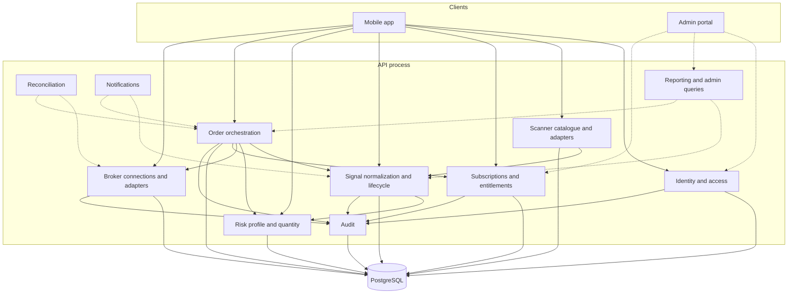
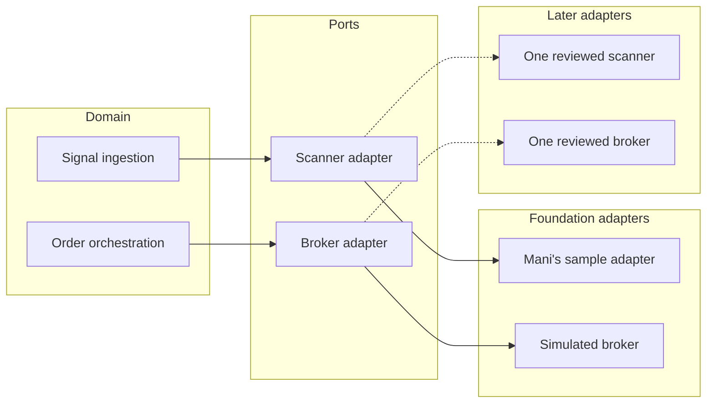

# Component model

The deployable pieces are the mobile app, the API process, and PostgreSQL. A worker and an admin portal join later as clients of the same API and the same database. Inside the API, modules are packages with their own models and services. They call each other through explicit functions, not through in-process events or a shared god service.



`Reconciliation`, `notifications`, and `reporting` are drawn because the domain needs a place for them. M1 only reserves their tables or, for reconciliation, the later job boundary. No component may reach around the broker adapter to infer a fill.

## Module contracts

| Module | Owns | May call | Must not |
| --- | --- | --- | --- |
| Identity and access | Users, OTP challenges, sessions, roles, permissions | Audit, risk profile creation on registration | Store the raw OTP or raw refresh token |
| Risk | Risk profile and the pure quantity function | Nothing provider-specific | Treat capital allocation as the loss budget |
| Scanners | Provider and scanner catalogue, scanner adapters | Signal ingestion | Embed Mani's field names in the signal table |
| Feeds | Per-channel feed settings and the Equity Telegram parser | Signal ingestion, audit | Store a Telegram session, `api_hash`, or an API secret. Call another project's database |
| Subscriptions | Subscription, entitlement, payment | Audit | Treat a payment row as permission to read signals |
| Signals | Normalized signals, deduplication, derived status | Subscription checks, risk calculation for a view | Execute an order |
| Orders | Intent, broker order, execution records, the submit policy | Signals, risk, subscriptions, broker adapter, audit | Trust client quantity; mark a protective order active before the broker says so |
| Brokers | Connection, account, position snapshots, broker adapters | Audit | Persist secrets; overwrite a snapshot with an internal estimate |
| Audit | Append-only events | Nothing in the domain | Accept a payload whose keys look like secrets |
| Notifications | Notification records and, later, delivery | Order and signal facts | Be the source of order state |
| Reporting | Read models for operators | Signals and orders, separately | Publish a combined win rate |
| Reconciliation | Compare internal intent with broker facts | Broker adapter, orders | Invent a fill to close a gap |

## Adapter ports

Two ports keep provider code out of the domain.



The scanner port returns normalized signals. The broker port covers authenticate, place, modify, cancel, get order, get trades, get positions, and get funds. The simulated broker implements the port and raises on every mutating call.

## Clients

| Client | Technology | Talks to | Status |
| --- | --- | --- | --- |
| Mobile app | React Native, Expo, TypeScript | `/api/v1` with a bearer token | Phase 1 screens: development sign-in, Mani's sample list, and signal detail |
| Admin portal | Next.js, TypeScript | Same API, admin permissions | M4 |
| Worker | Python process, durable jobs | Database and adapters | Introduced with webhooks and reconciliation |

The mobile app stores the refresh token in platform secure storage. It does not implement a second risk formula. It renders `source: provider` and `source: quantivo` as the API labels them.

## Cross-cutting behavior

| Concern | Where it lives |
| --- | --- |
| Configuration and the production guards | `app/core/config.py` |
| Sessions and permission checks | Identity models plus request dependencies |
| Correlation id | HTTP middleware, copied onto audit rows |
| JSON logs | Process logging configuration |
| Migrations | Alembic, one schema history for the monolith |
| Money | `Decimal` in Python, `numeric` in PostgreSQL |

## Repository layout

```text
docs/                  requirements and architecture
backend/app/core/      config, database, security, logging
backend/app/modules/   one package per component above
backend/alembic/       migrations
backend/tests/         API and domain tests
mobile/                Expo application, when scaffolded
infra/postgres/        local database init
docker-compose.yml     local PostgreSQL
```

Provider-specific files stay inside the adapter module. `mock_mani.py` and `simulated.py` are the only provider implementations in the foundation.
