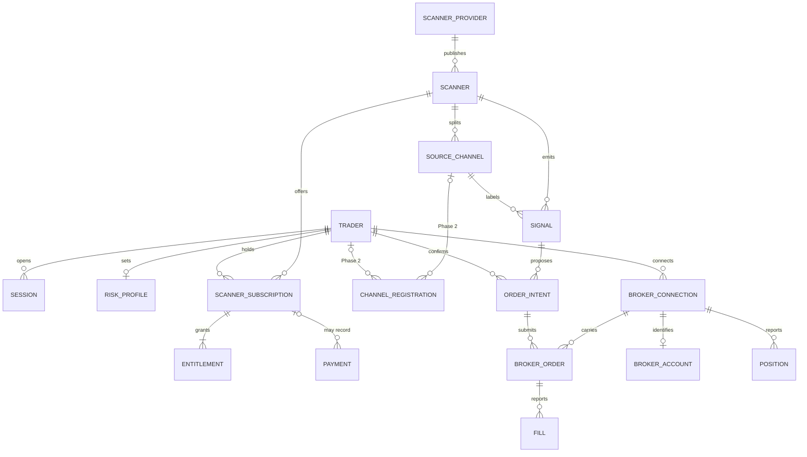
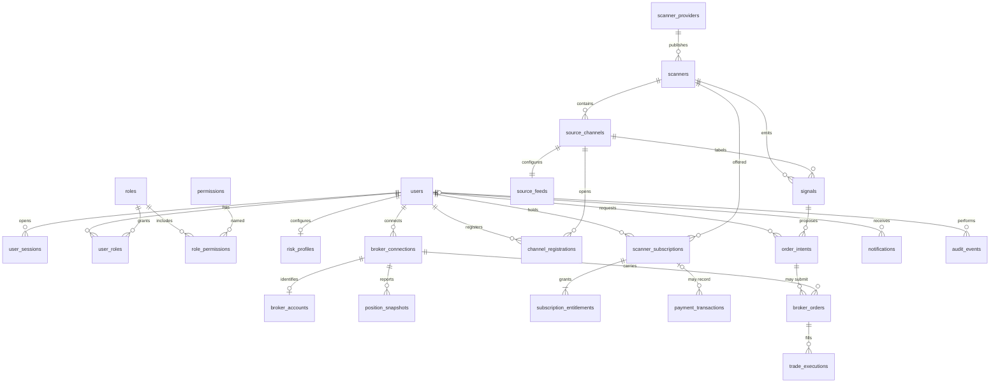
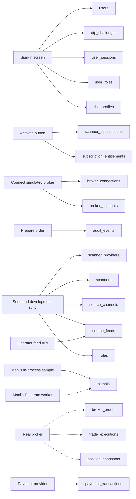

# Data architecture

**As of 23 October 2026.** PostgreSQL 16 is the system of record. The Phase 1 migration is `51909777e005_create_foundation_schema`. Identifiers are UUIDs. Timestamps are timezone-aware. Money is `numeric(18,2)`. Prices are `numeric(18,4)`. Status values are checked strings. Secrets are not columns.

The [domain model](DOMAIN_MODEL.md) states the business rules. This document states the logical model, the physical tables, the column definitions, and which source fills each table.

The review screen at `mockup/quantivo-mobile.html` writes nothing. Numbers typed there disappear on reload.

## 1. Logical data model

The logical model is the business shape. One entity here, channel registration, is not a table yet. It arrives in Phase 2. Order, fill, position, payment, and notification entities are tables already, and Phase 1 does not insert those rows.

| Subject | Logical entities | Rule that the tables must keep |
| --- | --- | --- |
| Identity | Trader, one-time challenge, role, permission, session | The phone number is the account. The one-time code is stored only as a hash. A session stores only the hash of the refresh token |
| Risk | Risk profile | One profile per trader. Maximum loss is at most the capital set aside. Quantity uses maximum loss, not capital |
| Catalogue | Provider, scanner, source channel, subscription, entitlement, payment, channel registration | Payment, subscription, and entitlement are three facts. Activation in this build writes the subscription and the entitlement and writes no payment. Channel registration is a later grant per Equity, F&O, or commodity channel |
| Signal | Signal | One row per scanner and provider reference. Segment comes from the source channel. Horizon words are stored as published. Stale is calculated when the row is read |
| Broker | Connection, account, order intent, broker order, fill, position | The connection stores no broker secret. A broker order and a fill are facts from the broker. Phase 1 records a simulated connection and inserts no order, fill, or position |
| Record | Audit event, notification | Audit is append-only and must not contain a code, token, password, or secret. Notifications are specified and not sent |

Quantity, risk-reward, and the stale flag are calculated for the screen. They are not columns.

## 2. Physical data model

Every entity above except channel registration is a table in database `quantivo`. Channel registration has no table. `otp_challenges` has no foreign key to `users`, because the challenge can exist before the account does.

Physical names, keys, and the phase that first inserts a row:

| Table | Primary key | Natural or unique key | First insert |
| --- | --- | --- | --- |
| `users` | `id` | `phone_e164` | Phase 1, first successful code |
| `otp_challenges` | `id` | phone plus `created_at` index | Phase 1, Send code |
| `roles` | `id` | `name` | Phase 1 seed |
| `permissions` | `id` | `code` | Phase 1 seed |
| `role_permissions` | `role_id`, `permission_id` | that pair | Phase 1 seed |
| `user_roles` | `user_id`, `role_id` | that pair | Phase 1, first successful code |
| `user_sessions` | `id` | `refresh_token_hash` | Phase 1, successful code |
| `risk_profiles` | `id` | `user_id` | Phase 1, server defaults on first code |
| `scanner_providers` | `id` | `code` | Phase 1 seed |
| `scanners` | `id` | `provider_id`, `code` | Phase 1 seed. An operator can add more. A new scanner has no price |
| `source_channels` | `id` | `scanner_id`, `code` | Phase 1 seed, one Equity channel. An operator can add more |
| `channel_registrations` | `id` | `user_id`, `source_channel_id` | One grant per trader and channel. A new channel starts without one |
| `source_feeds` | `id` | `source_channel_id` | Phase 1 seed, kind `none`, then an operator update |
| `scanner_subscriptions` | `id` | one `active` row per user and scanner | Phase 1, Activate |
| `subscription_entitlements` | `id` | user, scanner, status index | Phase 1, Activate |
| `payment_transactions` | `id` | `provider_ref` when present | Not in Phase 1 |
| `signals` | `id` | `scanner_id`, `external_ref` | Phase 1 seed and development sync |
| `call_clocks` | `id` | the single row `id = 1` | Migration inserts 30 minutes, 30 days, and 30 days. An admin can change that row |
| `broker_connections` | `id` | `user_id`, `broker_code` | Phase 1, Connect simulated broker |
| `broker_accounts` | `id` | `connection_id` | Phase 1, with that connection |
| `position_snapshots` | `id` | user and `captured_at` index | Phase 3, from the broker |
| `order_intents` | `id` | `idempotency_key` | Phase 3 |
| `broker_orders` | `id` | connection plus `broker_order_id` when present | Phase 3 simulated, Phase 5 real |
| `trade_executions` | `id` | `broker_order_id`, `external_trade_id` | Phase 3 simulated, Phase 5 real |
| `notifications` | `id` | user index | Phase 5 |
| `audit_events` | `id` | entity and actor indexes | Phase 1, beside the actions above |

`broker_connections` carries the comment that the table stores no broker password, OTP, access token, or API secret.

## 3. Data definition

`created_at` and `updated_at` are `timestamptz`, not null, on every table that uses the timestamp mixin. Tables that do not have both columns are named in the section.

### 3.1 Identity

**`users`**

| Column | Type | Null | Definition |
| --- | --- | --- | --- |
| `id` | uuid | no | Account identifier |
| `phone_e164` | varchar(16) | no | Indian mobile in E.164, unique. From the sign-in field after normalisation |
| `display_name` | varchar(80) | yes | Optional name. The Phase 1 screens do not send it |
| `status` | varchar(32) | no | `active`, `suspended`, or `closed` |
| `phone_verified_at` | timestamptz | yes | Set when the first code is accepted |

**`otp_challenges`** ? `created_at` only.

| Column | Type | Null | Definition |
| --- | --- | --- | --- |
| `id` | uuid | no | Challenge identifier returned to the app |
| `phone_e164` | varchar(16) | no | Number the code was requested for |
| `code_hash` | varchar(128) | no | HMAC of the phone and the code. The code itself is not stored |
| `expires_at` | timestamptz | no | Challenge expiry |
| `consumed_at` | timestamptz | yes | Set when the code is accepted, expired, or locked |
| `attempt_count` | integer | no | Failed checks. Five failures consume the challenge |
| `created_at` | timestamptz | no | Request time. Indexed with the phone |

**`roles`** ? no timestamp columns. `name` is unique. Seeded names are `user` and `admin`.

**`permissions`** ? no timestamp columns. `code` is unique. Seeded codes cover profile, catalogue, signals, the simulated broker, order requests, and the later admin reads.

**`role_permissions`** ? primary key is the pair `role_id`, `permission_id`. Both foreign keys cascade on delete.

**`user_roles`** ? primary key is the pair `user_id`, `role_id`. `granted_at` records when the role was attached. A new account receives `user` only.

**`user_sessions`** ? `created_at` only.

| Column | Type | Null | Definition |
| --- | --- | --- | --- |
| `id` | uuid | no | Session identifier carried in the access token |
| `user_id` | uuid | no | Account |
| `refresh_token_hash` | varchar(128) | no | SHA-256 of the current refresh token, unique |
| `expires_at` | timestamptz | no | Session expiry |
| `revoked_at` | timestamptz | yes | Set by logout |
| `device_label` | varchar(120) | yes | Client label. The app sends `quantivo-mobile` |
| `user_agent` | varchar(255) | yes | Request user agent |
| `last_seen_at` | timestamptz | yes | Updated on refresh |
| `created_at` | timestamptz | no | Session start |

### 3.2 Risk

**`risk_profiles`** ? one row per user.

| Column | Type | Null | Definition |
| --- | --- | --- | --- |
| `id` | uuid | no | Profile identifier |
| `user_id` | uuid | no | Account, unique |
| `capital_allocation_inr` | numeric(18,2) | no | Cash set aside. Positive. Not the quantity numerator. Default `50000.00` |
| `max_risk_inr` | numeric(18,2) | no | Maximum loss used for quantity. Positive and at most the capital. Default `500.00` |
| `max_quantity` | integer | yes | Optional share or unit cap. Default `500` |
| `max_exposure_inr` | numeric(18,2) | yes | Optional notional cap. Default `200000.00` |
| `allowed_products` | jsonb | no | `MIS`, `CNC`, or both. Default both |

### 3.3 Catalogue and access

**`scanner_providers`** ? `code` unique. `status` is `active` or `inactive`. Seeded row: code `mani`, name `Mani's`, monogram `M`.

**`scanners`** — unique `(provider_id, code)`. An operator adds a scanner with a provider name and a scanner name. The same provider name reuses the provider. Renaming that provider renames it for every scanner under it. Naming an existing provider moves the scanner. The scanner code stays unless the move would duplicate it. Deleting a scanner removes its channels. A channel with an order record keeps the scanner. A scanner added this way has no price and no channels until a channel is added under it.

| Column | Type | Null | Definition |
| --- | --- | --- | --- |
| `provider_id` | uuid | no | Provider |
| `code` | varchar(64) | no | `mani-channel` for the first scanner |
| `name` | varchar(120) | no | Trader-facing name, `Mani's Channel` |
| `description` | text | no | Catalogue copy |
| `category` | varchar(64) | no | Catalogue category. The seed uses `Intraday` |
| `price_inr` | numeric(18,2) | yes | Catalogue price. Seed `999.00`. Not a charge |
| `billing_frequency` | varchar(32) | yes | `monthly`, `quarterly`, or `annual` |
| `status` | varchar(32) | no | `active` or `inactive` |

There is no rating column and no subscriber-count column.

**`source_channels`** ? unique `(scanner_id, code)`.

| Column | Type | Null | Definition |
| --- | --- | --- | --- |
| `scanner_id` | uuid | no | Scanner |
| `code` | varchar(64) | no | `equity` in the Phase 1 seed |
| `name` | varchar(120) | no | `Equity` |
| `segment` | varchar(16) | no | `equity`, `fno`, or `commodity` |
| `horizon_aliases` | jsonb | no | Alias rules for this channel only. Seeded as `[]` |
| `status` | varchar(32) | no | `active` or `inactive` |

**`channel_registrations`** — unique `(user_id, source_channel_id)`.

| Column | Type | Null | Definition |
| --- | --- | --- | --- |
| `user_id` | uuid | no | Trader |
| `source_channel_id` | uuid | no | Channel they registered for |
| `status` | varchar(32) | no | `active` or `inactive` |

Scanner activation does not write this row. A scanner with one channel and no row still shows that channel. Adding a second channel records the existing channel for traders who already hold the scanner entitlement.

**`source_feeds`** ? one row per source channel.

| Column | Type | Null | Definition |
| --- | --- | --- | --- |
| `source_channel_id` | uuid | no | Channel. Unique. Removed with the channel |
| `kind` | varchar(32) | no | `none`, `telegram`, or `http_api` |
| `status` | varchar(32) | no | `active` or `inactive`. Inactive feeds are not polled |
| `options` | jsonb | no | Non-secret settings for that kind. Seeded as `{}`. A Telegram channel id and parser name live here. An HTTP feed may name an environment variable. The secret value does not |
| `history_synced_at` | timestamptz | yes | When the worker finished its one walk of that Telegram channel. Cleared if the channel id changes. Empty until then |

**`scanner_subscriptions`**

| Column | Type | Null | Definition |
| --- | --- | --- | --- |
| `user_id` | uuid | no | Account |
| `scanner_id` | uuid | no | Scanner |
| `status` | varchar(32) | no | `pending`, `active`, `expired`, or `revoked` |
| `activation_method` | varchar(32) | no | `provider_api`, `webhook`, `provider_managed`, or `admin_assisted` |
| `external_ref` | varchar(128) | yes | Provider reference when a later activation has one |
| `starts_at` | timestamptz | yes | Access start, when known |
| `ends_at` | timestamptz | yes | Access end, when known |

A partial unique index allows only one `active` row for a user and a scanner.

**`subscription_entitlements`** ? `created_at` only, plus `granted_at` and `revoked_at`.

| Column | Type | Null | Definition |
| --- | --- | --- | --- |
| `subscription_id` | uuid | no | Parent subscription |
| `user_id` | uuid | no | Account |
| `scanner_id` | uuid | no | Scanner |
| `status` | varchar(32) | no | `active` or `revoked` |
| `reason` | varchar(255) | no | Why the grant exists. Phase 1 writes `development_activation` |
| `granted_at` | timestamptz | no | Grant time |
| `revoked_at` | timestamptz | yes | Revoke time |

**`payment_transactions`**

| Column | Type | Null | Definition |
| --- | --- | --- | --- |
| `user_id` | uuid | no | Account |
| `subscription_id` | uuid | yes | Subscription, cleared if that subscription is removed |
| `amount_inr` | numeric(18,2) | no | Amount taken by a payment provider |
| `currency` | varchar(3) | no | `INR` |
| `status` | varchar(32) | no | `pending`, `succeeded`, `failed`, or `refunded` |
| `provider_ref` | varchar(128) | yes | Provider reference, unique when present |

### 3.4 Signals

**`signals`** ? unique `(scanner_id, external_ref)`.

| Column | Type | Null | Definition |
| --- | --- | --- | --- |
| `scanner_id` | uuid | no | Scanner |
| `source_channel_id` | uuid | no | Channel the call came from. Delete is restricted |
| `external_ref` | varchar(128) | no | Provider identity of the call. Sample values look like `mani-reliance-buy`. A later Telegram message uses channel id plus message id |
| `segment` | varchar(16) | no | Copied from the channel: `equity`, `fno`, or `commodity` |
| `horizon_raw` | varchar(80) | no | Horizon words as published. `Intraday` and `Intraday to 7 days` stay different strings |
| `symbol` | varchar(32) | no | Instrument name from the provider |
| `exchange` | varchar(16) | no | `NSE` or `BSE` |
| `side` | varchar(8) | no | `BUY` or `SELL` |
| `timeframe` | varchar(16) | no | `INTRADAY` or `POSITIONAL`. This is not the horizon text |
| `product_hint` | varchar(16) | no | `MIS` or `CNC` |
| `trigger_price` | numeric(18,4) | no | Provider trigger. Positive |
| `stop_loss` | numeric(18,4) | no | Provider stop. Positive |
| `targets` | jsonb | no | List of `{label, price}` from the provider |
| `provider_note` | text | yes | Provider note. Sample rows say they are not a recommendation |
| `status` | varchar(32) | no | Older rows may say `active`, `expired`, or `withdrawn`. The trader-facing mark does not read this column |
| `published_at` | timestamptz | no | Original publication time. A revision does not change it |
| `expires_at` | timestamptz | no | Provider expiry |
| `content_hash` | varchar(64) | no | Hash of provider content. Timestamps are excluded, so a repeat delivery does not revise the row |
| `lot_size` | integer | no | At least 1. Equity samples use 1 |
| `match_status` | varchar(16) | no | `matched`, `unmatched`, or `ambiguous`. Sample rows are `matched`. A channel row is `matched` when the posted name resolves to one NSE cash symbol, and that symbol is what is stored. An unmatched or ambiguous name is stored as written and is not executable |
| `origin` | varchar(16) | no | `sample` or `channel`. Sample rows stay out of the list once that channel's feed kind is `telegram` |

**`call_clocks`** — one row, `id = 1`. Admin configuration writes it. The stale mark is still calculated when a call is read.

| Column | Type | Null | Definition |
| --- | --- | --- | --- |
| `id` | integer | no | Always `1` |
| `intraday_minutes` | integer | no | Same-day Intraday and BTST. From 1 to 1440. Starts at 30 |
| `short_term_days` | integer | no | Horizon words that start with short. From 1 to 365. Starts at 30 |
| `long_term_days` | integer | no | Horizon words that start with long. From 1 to 365. Starts at 30 |

### 3.5 Broker and orders

**`broker_connections`**

| Column | Type | Null | Definition |
| --- | --- | --- | --- |
| `user_id` | uuid | no | Account |
| `broker_code` | varchar(64) | no | `simulated` or `zerodha`. Unique with the user. A Zerodha access token is not a column |
| `status` | varchar(32) | no | `disconnected`, `connected`, `expired`, or `unavailable` |
| `display_name` | varchar(120) | yes | `Simulated broker` |
| `external_account_ref` | varchar(128) | yes | A generated `SIM-` reference. Not a real broker account |
| `last_authenticated_at` | timestamptz | yes | When the simulated session was connected |
| `status_message` | varchar(255) | yes | Status copy. It states that orders are disabled |

**`broker_accounts`** ? one per connection. `external_account_id` repeats the simulated reference. `segments` is jsonb. Phase 1 writes `["NSE"]`.

**`position_snapshots`** ? append-only, `created_at` only. `source` is `broker` or `reconciliation`. Quantity and average price are broker facts. Phase 1 inserts none.

**`order_intents`** — unique `idempotency_key`, and one `proposed` row per trader and call. `side` is `BUY` or `SELL`. `product` is `MIS` or `CNC`. `trigger_price`, `stop_loss`, and `targets` are the prices the trader confirmed, filled from the call unless they edited them. `requested_quantity` and `validated_quantity` are the server quantity. `status` uses the lifecycle vocabulary from proposed through failed. A confirmation writes `proposed`. Orders lists that trader's rows. No broker order is written, and the stop is not active.

**`broker_orders`** ? `role` is `entry`, `stop_loss`, or `target`. `broker_order_id` is the broker's id and may be null before acceptance. `status` is the broker status. `quantity` is positive. `price` is the broker price when known. Phase 1 inserts none.

**`trade_executions`** ? `created_at` only. Unique `(broker_order_id, external_trade_id)`. `quantity` and `price` are positive. `executed_at` is the broker fill time. Phase 1 inserts none.

### 3.6 Audit and notifications

**`audit_events`** ? append-only, `created_at` only.

| Column | Type | Null | Definition |
| --- | --- | --- | --- |
| `actor_user_id` | uuid | yes | Account, kept if the user row is removed |
| `action` | varchar(64) | no | What happened, such as `auth.registered` or `order.refused` |
| `entity_type` | varchar(64) | no | Kind of row the event is about |
| `entity_id` | uuid | yes | That row, when it has an id |
| `payload` | jsonb | no | Safe details. A key that looks like a secret is rejected |
| `correlation_id` | varchar(64) | yes | Request id |
| `created_at` | timestamptz | no | Event time |

**`notifications`** ? `user_id`, `category`, `title`, `body`, `status` (`pending`, `sent`, `failed`, or `read`), and `read_at`. Phase 1 inserts none.

## 4. Lineage

A solid line is a write the current build performs. A dashed line is specified and not performed yet.

### 4.1 What Phase 1 writes

| Table | Who writes it | Where the values come from |
| --- | --- | --- |
| `roles`, `permissions`, `role_permissions` | `python -m app.seed` | Fixed reference data in the seed |
| `scanner_providers` | Seed | Provider code `mani`, name `Mani's`, monogram `M`. Not from the trader |
| `scanners` | Seed | `mani-channel`, name `Mani's Channel`, catalogue price ?999 monthly. The price is a description of the offer |
| `source_channels` | Seed | One row, code `equity`, segment `equity`, empty alias list |
| `source_feeds` | Seed, then `PUT /api/v1/admin/source-channels/{id}/feed` | Seed inserts kind `none` and does not replace a later operator choice. The operator sets `telegram` or `http_api` and that kind's options. The audit row records the kind and channel, not a secret |
| `signals` | Seed, and `POST /api/v1/dev/mock-feed/sync` after Activate | The in-process Mani's sample. It does not call Telegram. Prices, side, stop, targets, lot, horizon words, and provider status come from that sample. Segment comes from the Equity channel. The sync repeats the same calls and does not duplicate a row |
| `otp_challenges` | Send code | Phone from the sign-in field. The code is hashed. In development the response shows the code so the trader can type it. Production does not return it, and the table never stores it in clear text |
| `users` | First accepted code | Phone from the sign-in field. Status `active` |
| `user_roles` | First accepted code | The seeded `user` role |
| `risk_profiles` | First accepted code | Server defaults: capital ?50,000, maximum loss ?500, quantity cap 500, exposure cap ?2,00,000, MIS and CNC. The sign-in screen does not send these numbers. `PUT /api/v1/me/risk-profile` can change them and writes an audit row. The Phase 1 app has no screen that calls it |
| `user_sessions` | Accepted code, then refresh | New refresh-token hash. Device label from the app. User agent from the request. Logout sets `revoked_at` |
| `scanner_subscriptions` | Activate | The signed-in user and Mani's scanner. Status `active`, method `admin_assisted`. A second Activate does not insert a second active row |
| `subscription_entitlements` | Activate | Same user and scanner. Reason `development_activation`. This is what lets the feed be read |
| `broker_connections` | Connect simulated broker | Status `connected`, broker code `simulated`, a `SIM-` account reference, and a message that orders are disabled. Disconnect sets `disconnected` |
| `broker_accounts` | Connect simulated broker | The same simulated reference and segment `NSE` |
| `audit_events` | The actions above, and Prepare order | Action name, entity, and a payload checked for secret-like keys. Prepare order writes `order.refused` or `order.rejected_validation`. It does not write an order row |

The signal list and the signal detail only read. Suggested quantity is `floor(maximum loss / distance from trigger to stop)`, then lot and caps. Risk-reward is the distance from the trigger to a target divided by the distance from the trigger to the stop. Neither figure is stored.

### 4.2 What exists and stays empty in Phase 1

| Table | Later source | Why it stays empty now |
| --- | --- | --- |
| `payment_transactions` | A payment provider, linked to a subscription by `provider_ref` | Activate does not charge. Catalogue price is not a payment |
| `order_intents` | The confirm action in Phase 3, one row per idempotency key, before any broker call | Phase 1 validates and refuses |
| `broker_orders` | The simulated broker in Phase 3, then one real broker in Phase 5 | The simulated adapter records a connection and does not place, modify, cancel, or fill |
| `trade_executions` | Broker fill reports | No fill is created |
| `position_snapshots` | Broker positions, or a later reconciliation job | No position is captured |
| `notifications` | The API when a call, fill, protection event, or connection expiry must be pushed | Push delivery is Phase 5 |

### 4.3 Sources that are not connected

| Source | Table it will fill | Rule |
| --- | --- | --- |
| Mani's Telegram channel, on this app's worker | `signals` for scanner `mani-channel` when the Equity feed kind is `telegram` | The worker is `python -m app.feeds.worker`. It reads `source_feeds` in this database. It polls only when this worker has its own `TELEGRAM_API_ID`, `TELEGRAM_API_HASH`, and `TELEGRAM_SESSION_PATH`. It does not read the other Quantivo project. Posted names are resolved against a cached NSE cash list on this worker. Horizon words stay as published. `Intraday` is not rewritten to `Intraday to 7 days` |
| Trader, on the Phase 2 risk screen | `risk_profiles` | Capital, maximum loss, quantity cap, exposure cap, and MIS or CNC. Maximum loss cannot exceed capital |
| Trader, on the Phase 2 channel screen | A channel-registration table that does not exist yet | Registration is per Equity, F&O, or commodity channel. A segment filter does not grant access |
| Payment provider | `payment_transactions` | A successful payment is not itself an entitlement |
| Real broker | `broker_connections`, `broker_accounts`, `broker_orders`, `trade_executions`, `position_snapshots` | The broker is authoritative for orders, fills, and positions. Quantivo does not overwrite those facts. Secrets stay out of these tables |
| Operator, on Admin configuration after a normal sign-in, and through the feed API | `source_feeds`, `call_clocks`, and later users, providers, subscriptions, entitlements, and audit reads | `python -m app.grant_admin` attaches the admin role. The screen shows the shared Telegram login as present or missing and does not return its values. The three horizon clocks are saved on `call_clocks` and the audit payload is those three numbers. Operators cannot read broker secrets or the Telegram login |

### 4.4 Values the screen shows that are not stored

| Shown value | How it is produced |
| --- | --- |
| Development one-time code | Returned by the API only when the environment is development or test. Stored as `otp_challenges.code_hash` |
| Stale, and the warning on a call | Derived at read from the name match, `expires_at`, the horizon words, and the admin clocks. Same-day Intraday and BTST start at 30 minutes. Short term and long term start at 30 days. Unmatched and ambiguous names are not executable |
| Suggested quantity | Derived from `risk_profiles` and the signal trigger, stop, and lot. The trader may confirm another whole-lot quantity. A connected Zerodha session keeps it only when the available margin covers it |
| Risk-reward | Derived from trigger, stop, and each target. It does not change quantity |
| Feed mode `mock` | A response field. The rows are still normal `signals` rows |
