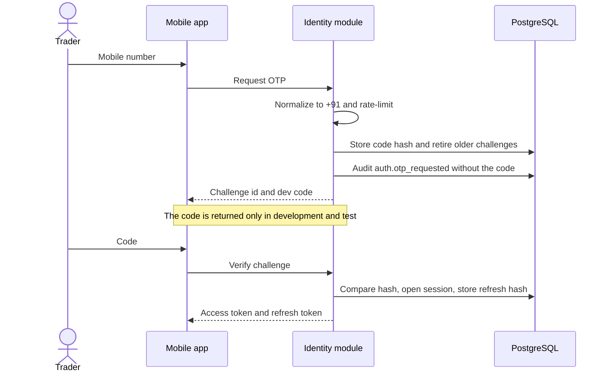
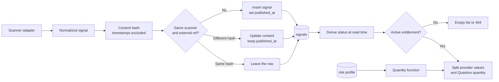
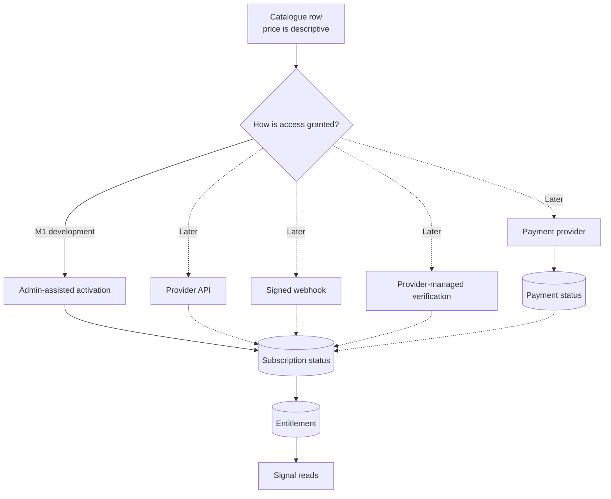
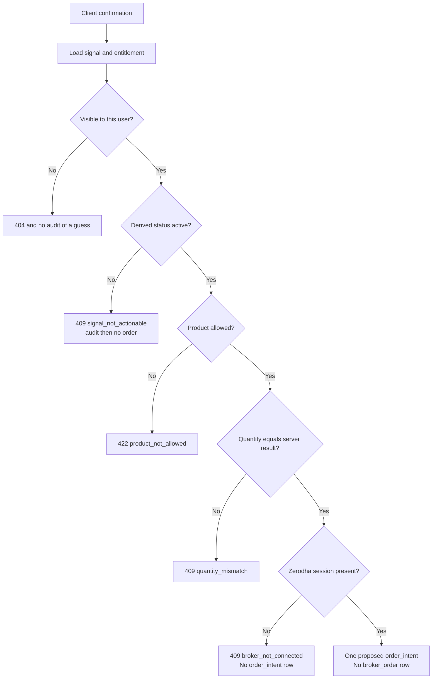
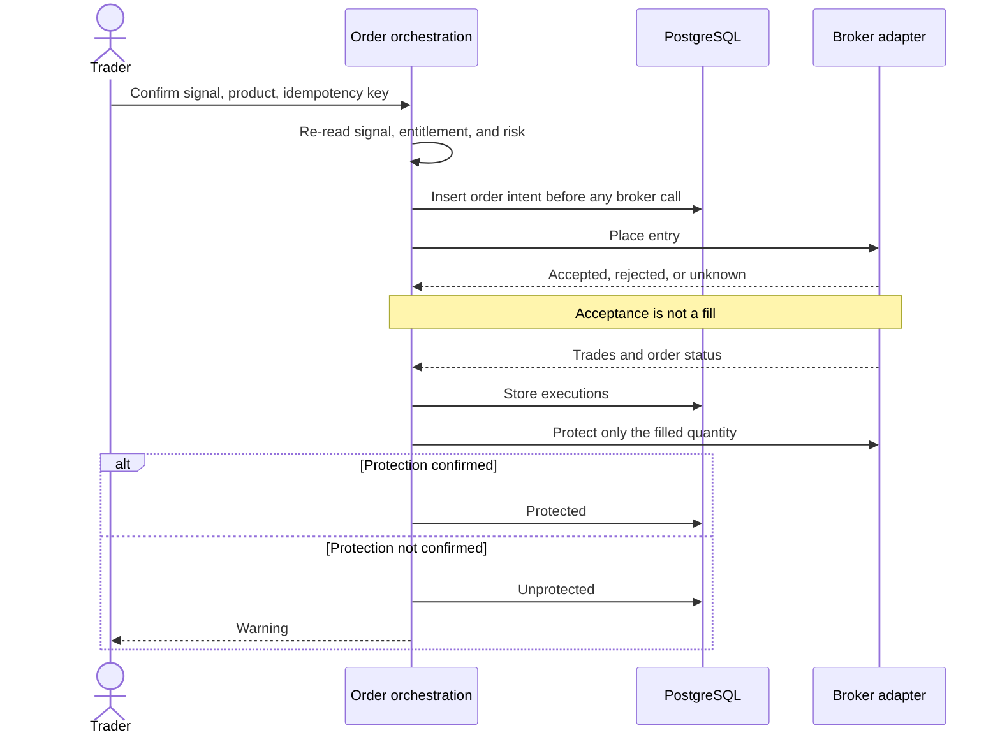

# Data flow

Four flows matter for the foundation. Later flows for fills, protection, and reconciliation are specified so the tables and ports already have a direction. They are not implemented.

## 1. Development sign-in

A wrong code increments the attempt count and commits that failure before the error is returned. After the attempt limit, the challenge is consumed. Logout sets `revoked_at` on the session. A still-unexpired access token is rejected when the session is revoked or expired.

Production does not have this return path. The process refuses to start while the development provider is selected.

## 2. Signal ingestion and display

The trader-facing status is not stored. A status word on the row is not read. Expiry is `expires_at` in the past. A same-day Intraday or BTST call older than its clock is stale. Short term and long term use their own clocks. Those clocks are the admin row, starting at 30 minutes, 30 days, and 30 days. Intraday to 7 days expires 7 days after the post. The price mark, and the minute of entry or exit, is read from Fyers one-minute bars for an NSE cash call. It is not a column. Not valid, Final, and Stop are not executable. Only a call that is still `active` and not on one of those marks is executable.

The content hash covers symbol, prices, targets, side, status, and the other provider fields. It excludes publication and expiry timestamps, so a repeated sync does not look like a new signal and does not extend an old one.

Mani's is the only adapter. Its sync is an authenticated development endpoint plus the seed command. Both call the same ingestion function. The development feed is an in-process sample under the Mani's name. It does not call Telegram.

## 3. Entitlement, kept apart from payment

Development activation writes a subscription with method `admin_assisted` and an entitlement with reason `development_activation`. It does not write a payment. A later checkout can succeed or fail on its own row. Reading signals checks the entitlement and the subscription together. If they disagree, access is denied.

One active subscription is allowed per user and scanner. A second active row is rejected by a partial unique index.

## 4. Order request in this build

Each rejection that passes the existence check commits an audit row. A passing confirmation stores one proposed intent for that trader and call. The same confirmation key returns that row. Zerodha is not asked to place the order. The stop and targets on the intent are not active. The broker adapter raises if something calls place, modify, or cancel anyway.

## 5. Target order flow after M3

This flow is the contract for the next trading milestone. It is not the M1 behavior.

Partial fills, cancel races, and restarts are handled by reconciliation against the broker, not by assuming the last HTTP response is still true.

## Data that must not move

| Data | Allowed store | Forbidden store |
| --- | --- | --- |
| OTP and refresh token | Hash only | Logs, audit payloads, client error bodies in production |
| Broker access token or password | The server secret directory for a Zerodha access token. The Kite api secret stays in the server environment file | `broker_connections`, `broker_accounts`, audit, logs, and the phone |
| Fyers quote app secret, PIN, client id, TOTP key, and access token | Server environment file | Tables, audit payloads, logs, and the phone after saving |
| Client-claimed quantity | Compared, then discarded | The quantity that is treated as authorized |
| Signal performance mixed with user fills | Separate report inputs | One blended return or win rate |
