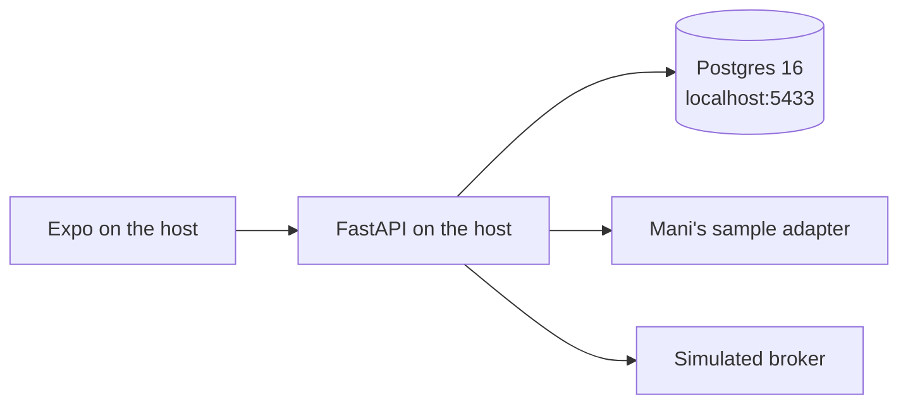
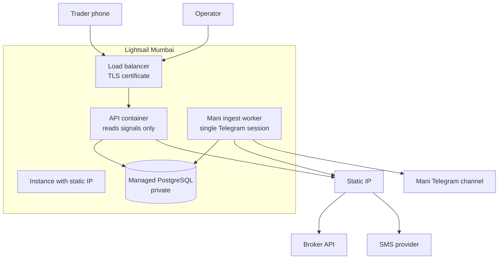
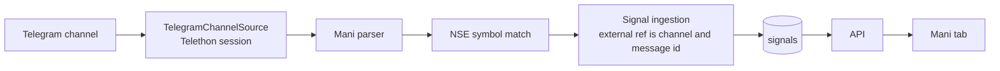
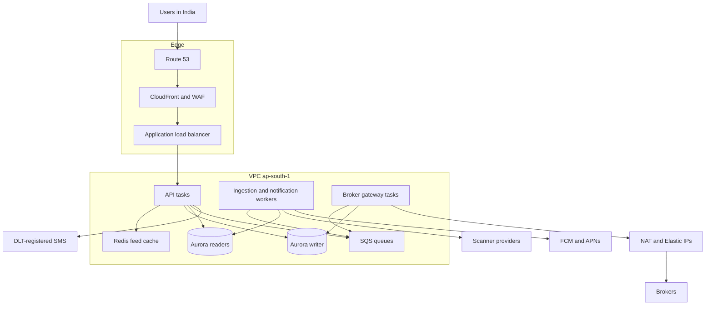

# Deployment architecture

Three environments, one application. Development runs on the developer machine. The first production deployment runs on Amazon Lightsail in Mumbai so a broker can whitelist a fixed egress address. The later production shape keeps that fixed-address idea and moves the app and the database onto an autoscaled VPC in `ap-south-1`.

The static IP is an egress constraint for broker APIs. It is not a reason to pin every user request to one machine, and it does not remove SEBI, exchange, or broker algo-trading obligations.

| | Development | First production | Scale production |
| --- | --- | --- | --- |
| Purpose | Build and test with mocks | Pilot, first broker whitelist, low thousands of users | Millions of users in India, hundreds of scanners, several brokers |
| Where | Developer machine | Lightsail, Mumbai | VPC in `ap-south-1`, with a later standby in `ap-south-2` |
| API | Uvicorn on the host | One container on one Lightsail instance | Many stateless API tasks behind a load balancer |
| Database | Postgres 16 in Docker, host port 5433 | Lightsail managed PostgreSQL, private to the instance | Aurora PostgreSQL, Multi-AZ, read replicas |
| Broker calls | Simulated adapter, no network | Instance static IP, whitelisted by the broker | One Elastic IP per broker, reached only by that broker's gateway tasks |
| Feed and notifications | Mani's sample, no network | One worker on the instance polls the Mani's Telegram channel | SQS workers, Redis feed cache, FCM and APNs. One task owns each Telegram session |
| Live trading | Cannot be enabled | Off until a reviewed adapter and an explicit later configuration | Still off until that same gate is passed |

## Development

No broker whitelist, no public endpoint, and no production OTP provider.

| Piece | How it runs |
| --- | --- |
| PostgreSQL | `docker compose up`. The container listens on host port 5433 because 5432 is already taken on the development machine. A second database, `quantivo_test`, is created for Pytest |
| API | Virtualenv on the host, `uvicorn`, reload on. Settings come from `backend/.env`, which is not committed |
| Mobile | Expo dev server. `EXPO_PUBLIC_API_BASE_URL` points at the host API |
| Auth | `AUTH_PROVIDER=dev_mock`. The one-time code is returned to the client |
| Scanners and brokers | In-process Mani's sample adapter and simulated broker. No outbound market or order calls |
| Secrets | Local `.env` only. The Compose database password is a local default |

A shared Lightsail box is not part of daily development. Add one only when a broker sandbox refuses any address except a pre-registered IP. That box uses its own static IP, its own database, and its own credentials. It does not reuse the production whitelist.

## First production on Lightsail

Lightsail is the pilot platform because a broker can register a static IP, and a single Mumbai instance is enough to operate that IP. The instance is one machine in one availability zone. Resize is vertical. There is no autoscaling group and no Multi-AZ failover.

### What runs where

| Component | Placement | Notes |
| --- | --- | --- |
| Mobile app | App Store and Play Store builds | The phone calls the load-balancer hostname. It does not know the static IP |
| TLS | Lightsail load balancer | Public HTTP is not offered. The certificate is attached to the load balancer |
| API | Docker container on the Lightsail instance | Same image that CI builds. One process family: the modular monolith |
| Worker | Second container on the same instance, from the first pilot | Polls the Mani Telegram channel and writes normalized signals. Same codebase and same database. The API container does not open Telegram |
| PostgreSQL | Lightsail managed PostgreSQL in Mumbai | Accept connections only from the application instance. Automated backups enabled. Restore is rehearsed before the pilot |
| Static IP | Attached to the application instance | This is the address given to the broker. Detaching it drops the whitelist, so it stays attached across restarts |
| Admin portal | Not in this environment until M4 | When it exists, it is another container behind the same load balancer and a separate hostname |
| Secrets | Environment file on the instance, readable only by the worker and API accounts | Telegram `api_id`, `api_hash`, and the Telethon session file live only with the worker. They are not in git, the image, the database, or the API process. The scale environment replaces the file with Secrets Manager |
| Logs | Instance logs shipped to CloudWatch | Each request already carries a correlation id |
| Backups | Managed-database backups, plus an instance snapshot before each release | Snapshots are not a substitute for a database backup |

Outbound broker and SMS calls leave through the instance static IP. The Mani worker also runs on that instance, so its Telegram session has one home. User traffic arrives through the load balancer. The broker never needs to accept a connection from the phone, and the phone never needs the whitelisted address.

### Broker constraint on this platform

One Lightsail instance has one static egress address. Several brokers can whitelist that same address when their contracts allow it. A broker that requires its own exclusive IP needs a second egress address, which this single instance cannot present. That requirement is a trigger to move to the scale network, where each broker has its own Elastic IP.

The broker adapter still runs inside the monolith. Lightsail does not introduce a broker microservice.

### First scanner: Mani over Telegram

The existing Mani desk already matches the scanner port. It lives today in the Quantivo AI app and is the first real feed this deployment will run. The phone tab only reads stored calls. A single background loop polls Telegram. Parsing is a pure function. Nothing in that loop places an order.

| Mani behaviour | Where it sits in this architecture |
| --- | --- |
| Telethon client, `api_id`, `api_hash`, and a user session file | Scanner adapter. It is the only code that speaks Telegram. One worker holds the session, because a Telethon session file cannot be shared by API replicas |
| Channel post becomes a `ChannelMessage` | Provider payload. The core never sees Telegram types |
| Parser requires a buy-above, a stop, and at least one target | Provider-specific rule inside the adapter. A missing stop or target is read from the immediate next message, the following message id within 10 minutes, and the call is stored under the first message. Any other incomplete post is ignored and not shown as a signal |
| Stop or target on the wrong side of the buy | Moved by a power of ten when the current price, or the buy, shows a missing zero or a slipped decimal. A level already on the right side is kept. The buy is kept |
| Company name resolved against the NSE equity list | Adapter step. `matched` becomes the signal symbol. `ambiguous` and `unmatched` stay visible and are not executable |
| Poll every few seconds from 09:15 to 15:30 IST, and ignore posts outside that window | Adapter clock. The core still marks a stored intraday signal stale from its own window |
| Dedup by channel id and message id | `external_ref` on the signal, unique per scanner |
| Horizon `intraday to 7 days` | Timeframe `INTRADAY`, product hint `MIS` |
| Horizon `short term` or `long term` | Timeframe `POSITIONAL`, product hint `CNC` |
| HTTP route that only lists stored calls | The API. The Mani tab does not connect to Telegram |
| `ManiOrderIntent` marked as not an order | Later confirm flow. This deployment still refuses live placement |
| Last traded price and target-hit marks | One Fyers data socket for the last price. Finished one-minute bars are saved, and a day already saved is not read again. The minute still forming is filled from that socket. A missing day is one paced History read. Both share this process's Data API budget. The pilot feed does not depend on them |

Suggested quantity on the platform stays `floor(maximum rupee risk / per-share risk)`, using the parsed buy-above as the trigger and the parsed stop as the stop. The Mani desk's current share count, capital divided by buy-above, is not the order quantity. The tab may show it only as a provider-style illustration, labeled apart from the Quantivo quantity.

Telegram does not need the broker static IP. The worker still runs on this instance so the session has one home and one egress address. Users are not asked to sign in to Telegram. Quantivo's entitlement decides who can see the Mani scanner. The Telegram membership belongs to the platform account that reads the channel.

At the later scale, this same worker role moves to a single ingestion task. API tasks keep reading the database and the feed cache. A second Telegram scanner is another adapter configuration and, if it needs its own user session, its own task. It is not another database.

### Pilot capacity

This shape fits a controlled pilot: one broker, a small set of scanners, and low thousands of registered users, with modest concurrency at the open. Leave it when any of these become true:

- The broker or a second broker requires another egress IP.
- A single availability zone is no longer an acceptable outage domain.
- API CPU, database connections, or database storage can no longer be satisfied by resizing the bundle.
- Webhook or notification volume interferes with interactive requests on the same instance.
- More than one environment (pilot and production) must be live at the same time.

### Release and access

CI builds one container image. An operator deploys that image to the instance and runs migrations against the managed database before the new process takes traffic. SSH is limited to operator addresses. The database has no public endpoint. Production configuration refuses `dev_mock` and refuses `LIVE_TRADING_ENABLED`.

## Scale production

This is the target once the pilot has a real broker and the user base moves from thousands toward millions. The application remains the modular monolith. What changes is the number of processes, the database topology, and the way broker traffic gets a stable address.

Primary region is Mumbai (`ap-south-1`), close to Indian users, Indian brokers, and Indian SMS routes. A passive standby in Hyderabad (`ap-south-2`) is for disaster recovery. Order intent stays on one writer. Active-active trading across regions is not part of this design.

### Request path and data path

| Tier | Role |
| --- | --- |
| CloudFront and WAF | Terminate untrusted internet traffic, filter abuse, and cache only public catalogue assets. Authenticated API responses are not cached at the edge |
| Application load balancer | Spreads phone and admin traffic across API tasks in more than one Mumbai availability zone |
| API tasks | Stateless containers of the same monolith. They validate, authorize, calculate quantity, and write order intent to the Aurora writer. They do not call brokers directly |
| Redis | Holds the current signal list per scanner. Every subscriber of a scanner reads the same payload. Per-user quantity is still calculated in the API from that user's risk profile |
| Aurora writer | Orders, entitlements, sessions, and audit. Multi-AZ |
| Aurora readers | Catalogue, signal history, and reporting. Signal statistics and execution statistics stay separate queries |
| SQS | Durable work: ingest a scanner payload, send a notification, reconcile a broker, submit an order to one broker |
| Ingestion workers | Pull scanner webhooks and polls off the API. Hundreds of scanners are hundreds of adapter configurations, with concurrency limits per provider |
| Broker gateway | A small set of tasks per broker. Each set uses one Elastic IP that the broker has whitelisted. An order queue per broker keeps one broker's outage or rate limit off the others |
| SMS | An Indian provider with DLT registration. The API asks it to send an OTP. The provider is not the session store |
| Push | Workers send FCM and APNs after the order or signal transaction commits |

API tasks scale with concurrent readers at the open. Gateway tasks stay few, because their job is a stable source address and a rate limit, not page views. Adding a broker means another gateway deployment, another Elastic IP, and another queue. It does not mean another database or another order service.

### Why the static IP moves

On Lightsail the whitelisted address is the application instance. At this scale the whitelisted address is a NAT Elastic IP in front of the broker gateway only. API tasks sit in private subnets and can come and go. Scanner polling uses a different egress address from order placement, so a large scanner sync cannot exhaust the broker's view of Quantivo's source IP.

Brokers that whitelist a single Quantivo IP keep working. The address they whitelist changes once, during the move off Lightsail, and is then stable.

### Data growth

Append-only tables — audit events, notifications, executions, and position snapshots — are partitioned by month. Hot partitions stay on the writer. Cold partitions move to cheaper storage. User, subscription, and current-signal rows stay on the primary and remain small relative to those logs.

Feed reads hit Redis first. A cache miss reads Aurora and refills Redis. Entitlement is checked in Aurora on each session's signal read; a cached feed is never treated as permission.

### Failure domains

| Failure | Behaviour |
| --- | --- |
| One API task dies | The load balancer stops using it. In-flight requests retry. No broker call was in that task |
| One availability zone fails | API tasks and Aurora's standby continue in the other Mumbai zones |
| Redis fails | The API reads signals from Aurora. Latency rises. Orders continue |
| One broker gateway or broker API fails | That broker's queue backs up and retries. Other brokers keep their own queues. Affected users see an unavailable connection. No order is guessed |
| Mumbai region fails | The Hyderabad standby is promoted from a recent Aurora replica and the Elastic IPs are reattached by a rehearsed runbook. This is a recovery, not continuous trading through the outage |
| Worker falls behind | Interactive reads and new intents still succeed. Notifications and reconciliation lag visibly |

### What this scale shape still is

One codebase. One writer for intent and entitlements. Adapter code inside the workers that need it. The ingestion worker and the broker gateway are process roles of that codebase, deployed separately so their scaling knobs differ. They are not a microservice per scanner or per broker.

## Moving from Lightsail to the VPC

The move is a network change, then a data change.

1. Register the new broker Elastic IPs with each broker and keep the Lightsail static IP until the broker confirms the new addresses.
2. Restore the latest managed-database backup into Aurora and rehearse the application against it.
3. Freeze writes, take a final backup, restore the delta, and run the API tasks against Aurora.
4. Shift DNS from the Lightsail load balancer to the Mumbai load balancer.
5. Watch broker egress from the new Elastic IPs, then release the Lightsail static IP so it cannot keep sending orders.

Orders are not dual-written to both databases during the cut. Two writers would create two intents for one confirmation.
