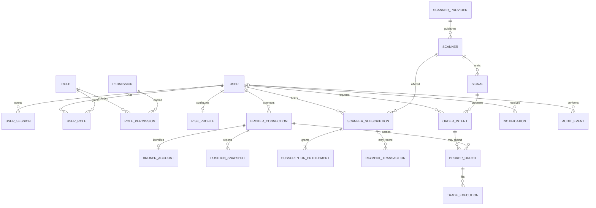

# Domain model

The logical model, the physical tables, the column definitions, and the lineage of each table are in [DATA_ARCHITECTURE.md](DATA_ARCHITECTURE.md).

PostgreSQL is the system of record. Identifiers are UUIDs. Timestamps are timezone-aware. Status values are constrained strings, not database enums, so a new status is a migration of a check rather than a type rewrite. Foreign keys are indexed where they are filtered. Secrets are not columns on these tables.

`ORDER_INTENT`, `BROKER_ORDER`, `TRADE_EXECUTION`, and `POSITION_SNAPSHOT` are part of the model now so later fills have a place to land. The foundation does not write them.

## Identity

| Entity | Keys and rules |
| --- | --- |
| User | Unique `phone_e164`. Status is `active`, `suspended`, or `closed` |
| OTP challenge | Hash of the code, expiry, consumed time, attempt count. Indexed by phone and creation time. Not an audit of the code itself |
| Role and permission | `user` and `admin` are seeded. Permissions are attached through role-permission rows |
| User session | Unique hash of the current refresh token. Expiry and `revoked_at`. Logout and reuse of an old refresh token both fail closed |

## Risk and brokers

| Entity | Keys and rules |
| --- | --- |
| Risk profile | One per user. Capital and max risk are positive. Max risk is less than or equal to capital. Optional quantity and exposure caps are positive when set |
| Broker connection | Unique per user and broker code. Status is `disconnected`, `connected`, `expired`, or `unavailable`. No secret columns. Comment on the table records that rule |
| Broker account | One per connection. External account id and segments only |
| Position snapshot | Append-only. Source is `broker` or `reconciliation`. Indexed by user and capture time |

## Catalogue and access

| Entity | Keys and rules |
| --- | --- |
| Scanner provider | Unique code. Status `active` or `inactive` |
| Scanner | Unique `(provider, code)`. Optional price and billing frequency. No rating and no subscriber-count column |
| Scanner subscription | Status `pending`, `active`, `expired`, or `revoked`. Activation method is `provider_api`, `webhook`, `provider_managed`, or `admin_assisted`. Partial unique index: one `active` row per user and scanner |
| Source channel | Unique `(scanner, code)`. One market segment. A scanner with no extra channels has one implicit channel. Alias rules belong to this channel and do not apply elsewhere |
| Source feed | One row per source channel. Kind is `none`, `telegram`, or `http_api`. Options differ by kind and do not contain secrets |
| Channel registration | Unique active row per user and channel. Same activation methods as a scanner subscription. Does not itself create a payment |
| Subscription entitlement | Status `active` or `revoked`. Indexed by user, scanner, and status. Reason is required |
| Payment transaction | Status `pending`, `succeeded`, `failed`, or `refunded`. Unique provider reference when one exists. Nullable link to a subscription |

Access to signals requires an active entitlement whose subscription is also active. When the scanner has more than one source channel, the signal's channel must also be registered to that user. A segment filter does not change access. Horizon text is display data on the call.

## Signals and orders

| Entity | Keys and rules |
| --- | --- |
| Signal | Unique `(scanner, external_ref)`. Side, timeframe, product hint, exchange, positive prices, and lot size are checked. Segment is `equity`, `fno`, or `commodity`, taken from the source channel. The channel and the published horizon text are both stored. Match status is `matched`, `unmatched`, or `ambiguous`. The trader-facing mark is generated from the match, `expires_at`, the horizon clock, and the entry window. A stored status word is not that mark. Unmatched and ambiguous are not executable |
| Order intent | Unique idempotency key. Status uses the full lifecycle vocabulary. Positive requested quantity. Written from M3 onward |
| Broker order | Role is `entry`, `stop_loss`, or `target`. External broker order id is unique per connection when present. Null external ids may repeat, which is what a not-yet-accepted order needs |
| Trade execution | Unique `(broker order, external trade id)`. Positive quantity and price |
| Notification | Status `pending`, `sent`, `failed`, or `read`. Delivery is later |
| Audit event | Append-only. Actor is nullable so a deleted user does not destroy history. Payload is JSON and is rejected by the application if a key looks like a secret. Indexed by entity and by actor |

## Invariants the application keeps even when the database cannot see them

- Derived signal status, not the stored status alone, decides whether an order may be attempted.
- Quantity used for an order is the server's quantity at that moment.
- A development activation does not insert a payment.
- A simulated connection does not insert a broker order.
- Audit payloads do not contain OTP, token, password, secret, or credential fields.

The Phase 1 migration creates these tables, including one source channel on each signal. A later migration adds `source_feeds` and `signals.match_status`. Channel registration is Phase 2 and does not have a table yet.
