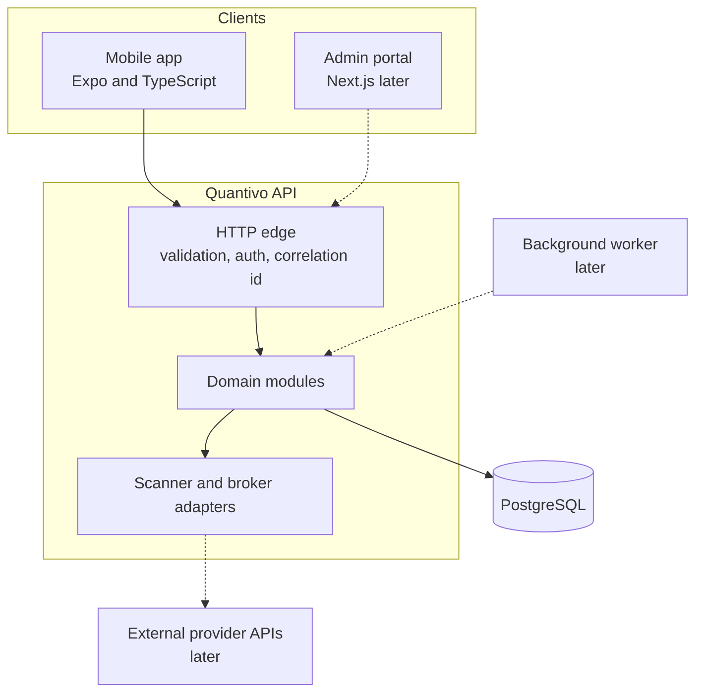
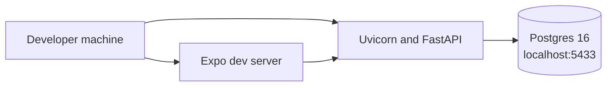
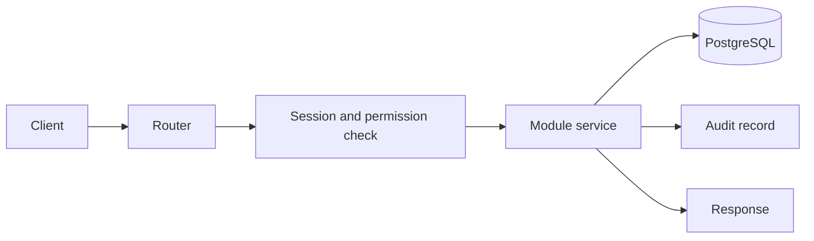

# Architecture overview

Quantivo is one backend and two clients. The backend is a modular monolith. The mobile app is the trader's client. The admin portal is a second client and is not part of the foundation. PostgreSQL is the system of record. Scanner providers and brokers are integrated only through adapters.

The HTTP edge authenticates the caller, validates the body, and stamps a correlation id. Domain modules own the rules. Adapters translate those rules into one provider's protocol. The database stores intent, entitlements, and history. It does not store broker secrets.

## Runtime for the foundation

Local development runs PostgreSQL in Docker, published on host port 5433. The API and the mobile app run on the host so reload stays simple. There is no Redis, queue, or API gateway in this stage. Webhook intake, notification delivery, and reconciliation will need a durable worker later. That worker is a process boundary, not a new service with its own database.

The first production deployment is a Lightsail instance in Mumbai with a static egress IP for broker whitelisting. The later production network keeps that fixed-address idea on a NAT path and scales the API separately. Both are drawn in [DEPLOYMENT.md](DEPLOYMENT.md).

## Request path

Every authenticated call follows the same shape.

Services commit their own successful unit of work. A refused order still commits its audit row, then returns an error. The response never includes a stack trace, an OTP, or a token.

## What the foundation deliberately is not

- It is not a trading venue and not a broker.
- It is not a single scanner with the platform name painted on it.
- It is not a set of microservices.
- It does not turn a development shortcut into a production path. Production refuses the development OTP provider, and no environment can enable live trading in this build.

## Build sequence

The modules exist so later milestones extend them instead of bypassing them.

| Now | Next | After a regulatory and API review |
| --- | --- | --- |
| Development OTP, mock scanner, quantity display, simulated connection, order refusal | Mobile signal screens, then simulated fills and protection | One real scanner adapter and one real broker adapter |

The order path's future shape is fixed now, so M1 does not invent a second path that M3 would have to throw away. M1 validates and refuses. M3 persists an intent and then calls the adapter. The adapter method that places an order already raises until that milestone.
