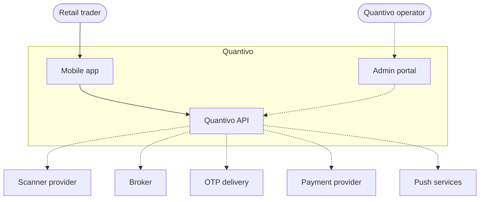
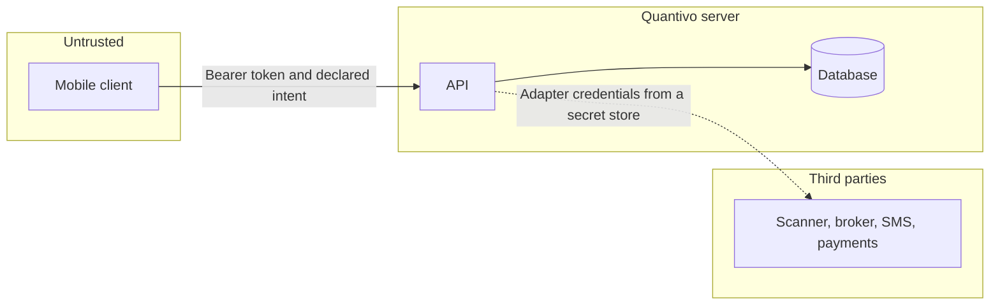

# System context

Quantivo sits between a trader and two kinds of external specialist: the scanner that produces a signal, and the broker that would execute it. Quantivo does not replace either of them.

Solid lines are the foundation path: a trader, the mobile app, and the API. Dashed lines are specified integrations. None of those external systems are called in the current build. The Mani's sample adapter and the simulated broker stand in for the live channel and the broker so the domain can be exercised without their networks.

## Responsibility at the boundary

| Party | Owns | Does not own |
| --- | --- | --- |
| Trader | Phone number, risk preferences, confirmation of an order, choice of product | The truth of a fill or a position |
| Scanner provider | Signal content, its own subscription product, its own identity in the UI | Quantivo entitlements, quantity, or order state |
| Broker | Authentication session, orders, fills, positions, funds, and whether a protective order is actually working | The user's risk preference or the scanner's original text |
| Payment provider | Collection, failure, and refund of money | Whether the user may read signals |
| OTP delivery | Delivering a one-time code in production | Deciding that a session is valid |
| Quantivo | Normalization, entitlement, risk math, orchestration, audit, and a clear failure when a dependency is unavailable | Becoming a scanner, broker, or payment institution |

## Trust boundaries

The mobile client is untrusted for price, quantity, entitlement, and order state. It can display server results and submit a confirmation. The server recalculates risk and re-reads the signal before it will accept an order request.

Third parties are outside the trust boundary even after integration. Their payloads are validated into the normalized model. Their credentials, when a real adapter exists, stay in a secret store and out of the application tables.

## Context for this build

In the foundation, the third-party box is empty on the network. The substitutes are:

- **Development OTP.** The API generates a code, stores a hash, and returns the code only when the environment is development or test.
- **Mani's.** A deterministic in-process sample of the first scanner. The catalogue uses that name. The sample does not call Telegram.
- **Simulated broker.** A connection row and an adapter whose mutating methods refuse. No credential columns exist.

Those substitutes implement the same interfaces the later real adapters must implement. They are not hidden `if success` branches in the domain.
